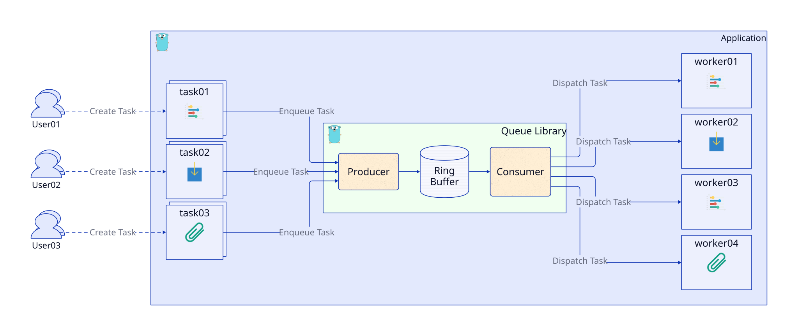
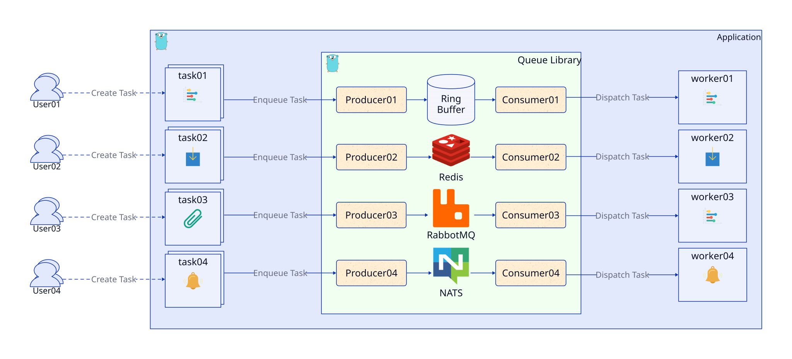
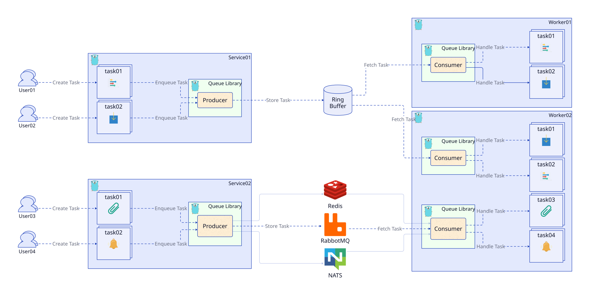

# Queue

[](https://github.com/golang-queue/queue/actions/workflows/codeql.yaml)
[](https://github.com/golang-queue/queue/actions/workflows/go.yml)
[](https://codecov.io/gh/golang-queue/queue)
[](https://github.com/golang-queue/queue/actions/workflows/security.yml)

[繁體中文](./README.zh-tw.md) | [简体中文](./README.zh-cn.md)

Queue is a Golang library designed to help you create and manage a pool of Goroutines (lightweight threads). It allows you to efficiently run multiple tasks in parallel, utilizing the full CPU capacity of your machine.

## Contents

- [Installation](#installation)
- [Usage](#usage)
- [Configuration and lifecycle](#configuration-and-lifecycle)
- [Development](#development)
- Backends: [NSQ](#using-nsq-as-a-queue), [NATS](#using-nats-as-a-queue), [Redis Pub/Sub](#using-redis-pubsub-as-a-queue)

## Features

- [x] Supports [Circular buffer](https://en.wikipedia.org/wiki/Circular_buffer) queues.
- [x] Integrates with [NSQ](https://nsq.io/) for real-time distributed messaging.
- [x] Integrates with [NATS](https://nats.io/) for adaptive edge and distributed systems.
- [x] Integrates with [Redis Pub/Sub](https://redis.io/docs/manual/pubsub/).
- [x] Integrates with [Redis Streams](https://redis.io/docs/manual/data-types/streams/).
- [x] Integrates with [RabbitMQ](https://www.rabbitmq.com/).

## Queue Scenario

A simple queue service using a ring buffer as the default backend.



Easily switch the queue service to use NSQ, NATS, or Redis.



Supports multiple producers and consumers.



## Requirements

The current branch requires Go **1.26.10** or above, as declared in [go.mod](./go.mod). Requirements for tagged releases may differ.

## Installation

To install the latest tagged release:

```sh
go get github.com/golang-queue/queue@latest
```

To install the development branch:

```sh
go get github.com/golang-queue/queue@master
```

## Usage

### Basic Usage of Pool (using the Task function)

By calling the `QueueTask()` method, you can schedule tasks to be executed by workers (Goroutines) in the pool.

```go
package main

import (
	"context"
	"fmt"

	"github.com/golang-queue/queue"
)

func main() {
	taskN := 100
	rets := make(chan string, taskN)

	// initialize the queue pool
	q := queue.NewPool(5)
	// shut down the service and notify all workers
	// wait until all jobs are complete
	defer q.Release()

	// assign tasks to the queue
	for i := 0; i < taskN; i++ {
		if err := q.QueueTask(func(ctx context.Context) error {
			rets <- fmt.Sprintf("Hi Gopher, handle the job: %02d", i)
			return nil
		}); err != nil {
			panic(err)
		}
	}

	// wait until all tasks are done
	for i := 0; i < taskN; i++ {
		fmt.Println("message:", <-rets)
	}
}
```

### Basic Usage of Pool (using a message queue)

Define a new message struct and implement the `Bytes()` function to encode the message. Use the `WithFn` function to handle messages from the queue.

```go
package main

import (
	"context"
	"encoding/json"
	"fmt"

	"github.com/golang-queue/queue"
	"github.com/golang-queue/queue/core"
)

type job struct {
	Name    string
	Message string
}

func (j *job) Bytes() []byte {
	b, err := json.Marshal(j)
	if err != nil {
		panic(err)
	}
	return b
}

func main() {
	taskN := 100
	rets := make(chan string, taskN)

	// initialize the queue pool
	q := queue.NewPool(5, queue.WithFn(func(ctx context.Context, m core.TaskMessage) error {
		var v job
		if err := json.Unmarshal(m.Payload(), &v); err != nil {
			return err
		}

		rets <- "Hi, " + v.Name + ", " + v.Message
		return nil
	}))
	// shut down the service and notify all workers
	// wait until all jobs are complete
	defer q.Release()

	// assign tasks to the queue
	for i := 0; i < taskN; i++ {
		if err := q.Queue(&job{
			Name:    "Gopher",
			Message: fmt.Sprintf("handle the job: %d", i+1),
		}); err != nil {
			panic(err)
		}
	}

	// wait until all tasks are done
	for i := 0; i < taskN; i++ {
		fmt.Println("message:", <-rets)
	}
}
```

## Configuration and lifecycle

`NewPool(n, opts...)` creates an in-memory ring buffer and starts processing immediately. A nonpositive `n` uses `runtime.NumCPU()`. `NewQueue(opts...)` requires `WithWorker(...)`, returns an error if the worker is missing, and requires an explicit `Start()` call.

`QueueTask` submits a Go function for in-process execution. Use `Queue` with a message implementing `Bytes() []byte` for serialized payloads; the handler reads the original payload with `core.TaskMessage.Payload()`. For the default ring buffer, configure the handler with `WithFn`: its default is a no-op. Function closures are not serialized for external backends.

Both submission methods return enqueue errors, not the eventual task result. Workers execute tasks concurrently, so completion order is not guaranteed. The examples submit tasks directly; an extra goroutine per submission is unnecessary. Their result channels are buffered for all tasks and assume each accepted task sends one result. For fallible handlers, send an explicit result containing the error too, so the caller does not wait forever.

| Option | Default | Behavior |
| --- | --- | --- |
| `WithQueueSize(n)` | `0` (unlimited) | Limits pending tasks in the ring buffer, excluding running tasks. A full buffer returns `ErrMaxCapacity` immediately. |
| `WithWorkerCount(n)` | `runtime.NumCPU()` | Sets execution concurrency; overrides the size passed to `NewPool` when supplied there. |
| `WithRetryInterval(d)` | `time.Second` | Polling interval when no work is available; must be positive. This is not the task retry delay. |
| `WithLogger(logger)` | Standard stderr logger | Use `NewEmptyLogger()` to disable logging. |
| `WithAfterFn(fn)` | None | Runs after task accounting, for success or failure. Callbacks can overlap; synchronize shared state. |

Stop producers before calling `Release()`. With the default ring buffer, shutdown rejects new submissions with `ErrQueueShutdown` and drains pending tasks. `Release()` also waits for queue-managed goroutines and completion callbacks. Shutdown can cancel active task contexts; it does not promise that every task succeeds. Drain behavior for external backends depends on their worker implementation.

`Wait()` waits for queue goroutines to exit; it is not a way to wait for an idle queue while leaving it running. Use application-level completion signals for that. Keep workers running during draining: `UpdateWorkerCount(0)` pauses dispatch, so restore a positive count before releasing a pool with pending tasks. Do not call `Release()` from a task or completion callback, because it would wait for itself.

### Task retries and timeouts

Pass one `job.AllowOption` value to `QueueTask` or `Queue` to override job defaults. Import `github.com/golang-queue/queue/job` and `time` for the options below:

```go
opts := job.AllowOption{
    RetryCount: job.Int64(3),
    RetryDelay: job.Time(200 * time.Millisecond),
    Timeout:    job.Time(5 * time.Second),
}
// Pass opts as the second argument to q.QueueTask or q.Queue.
```

By default, jobs have no retries and a 60-minute timeout. `RetryCount: 3` permits up to four attempts when handlers return errors. With a zero retry delay, exponential backoff starts at 100 ms, doubles, and is capped at 10 seconds. The timeout covers the whole job, including retries and delays.

Handlers should honor `ctx.Done()` and pass the context to cancellable I/O. A timeout records failure but cannot forcibly stop a Go function that ignores cancellation; such a function may keep running after `Release()` returns. Make retryable operations safe to repeat.

### Metrics

Use `SubmittedTasks()`, `CompletedTasks()`, `SuccessTasks()`, `FailureTasks()`, and `BusyWorkers()` to inspect the queue. Retries belong to the same job rather than separate submissions. Read final counters after `Release()`; concurrent reads are snapshots, not a transaction.

## Development

Run the test suite from the repository root:

```sh
go test ./...
go test -race ./...
```

See [runnable examples](./_example/) and the [worker interface](./core/worker.go) for further integration details. External backends require their own Go module and running service; follow the linked backend documentation below for setup and delivery guarantees.

## Using NSQ as a Queue

Refer to the [NSQ documentation](https://github.com/golang-queue/nsq) for more details.

```go
package main

import (
	"context"
	"encoding/json"
	"fmt"

	"github.com/golang-queue/nsq"
	"github.com/golang-queue/queue"
	"github.com/golang-queue/queue/core"
)

type job struct {
	Message string
}

func (j *job) Bytes() []byte {
	b, err := json.Marshal(j)
	if err != nil {
		panic(err)
	}
	return b
}

func main() {
	taskN := 100
	rets := make(chan string, taskN)

	// define the worker
	w := nsq.NewWorker(
		nsq.WithAddr("127.0.0.1:4150"),
		nsq.WithTopic("example"),
		nsq.WithChannel("foobar"),
		// concurrent job number
		nsq.WithMaxInFlight(10),
		nsq.WithRunFunc(func(ctx context.Context, m core.TaskMessage) error {
			var v job
			if err := json.Unmarshal(m.Payload(), &v); err != nil {
				return err
			}

			rets <- v.Message
			return nil
		}),
	)

	// define the queue
	q := queue.NewPool(
		5,
		queue.WithWorker(w),
	)

	// assign tasks to the queue
	for i := 0; i < taskN; i++ {
		if err := q.Queue(&job{
			Message: fmt.Sprintf("handle the job: %d", i+1),
		}); err != nil {
			panic(err)
		}
	}

	// wait until all tasks are done
	for i := 0; i < taskN; i++ {
		fmt.Println("message:", <-rets)
	}

	// shut down the service and notify all workers
	q.Release()
}
```

## Using NATS as a Queue

Refer to the [NATS documentation](https://github.com/golang-queue/nats) for more details.

```go
package main

import (
	"context"
	"encoding/json"
	"fmt"
	"log"

	"github.com/golang-queue/nats"
	"github.com/golang-queue/queue"
	"github.com/golang-queue/queue/core"
)

type job struct {
	Message string
}

func (j *job) Bytes() []byte {
	b, err := json.Marshal(j)
	if err != nil {
		panic(err)
	}
	return b
}

func main() {
	taskN := 100
	rets := make(chan string, taskN)

	// define the worker
	w := nats.NewWorker(
		nats.WithAddr("127.0.0.1:4222"),
		nats.WithSubj("example"),
		nats.WithQueue("foobar"),
		nats.WithRunFunc(func(ctx context.Context, m core.TaskMessage) error {
			var v job
			if err := json.Unmarshal(m.Payload(), &v); err != nil {
				return err
			}

			rets <- v.Message
			return nil
		}),
	)

	// define the queue
	q, err := queue.NewQueue(
		queue.WithWorkerCount(10),
		queue.WithWorker(w),
	)
	if err != nil {
		log.Fatal(err)
	}

	// start the workers
	q.Start()

	// assign tasks to the queue
	for i := 0; i < taskN; i++ {
		if err := q.Queue(&job{
			Message: fmt.Sprintf("handle the job: %d", i+1),
		}); err != nil {
			panic(err)
		}
	}

	// wait until all tasks are done
	for i := 0; i < taskN; i++ {
		fmt.Println("message:", <-rets)
	}

	// shut down the service and notify all workers
	q.Release()
}
```

## Using Redis (Pub/Sub) as a Queue

Refer to the [Redis documentation](https://github.com/golang-queue/redisdb) for more details.

```go
package main

import (
	"context"
	"encoding/json"
	"fmt"
	"log"

	"github.com/golang-queue/queue"
	"github.com/golang-queue/queue/core"
	"github.com/golang-queue/redisdb"
)

type job struct {
	Message string
}

func (j *job) Bytes() []byte {
	b, err := json.Marshal(j)
	if err != nil {
		panic(err)
	}
	return b
}

func main() {
	taskN := 100
	rets := make(chan string, taskN)

	// define the worker
	w := redisdb.NewWorker(
		redisdb.WithAddr("127.0.0.1:6379"),
		redisdb.WithChannel("foobar"),
		redisdb.WithRunFunc(func(ctx context.Context, m core.TaskMessage) error {
			var v job
			if err := json.Unmarshal(m.Payload(), &v); err != nil {
				return err
			}

			rets <- v.Message
			return nil
		}),
	)

	// define the queue
	q, err := queue.NewQueue(
		queue.WithWorkerCount(10),
		queue.WithWorker(w),
	)
	if err != nil {
		log.Fatal(err)
	}

	// start the workers
	q.Start()

	// assign tasks to the queue
	for i := 0; i < taskN; i++ {
		if err := q.Queue(&job{
			Message: fmt.Sprintf("handle the job: %d", i+1),
		}); err != nil {
			panic(err)
		}
	}

	// wait until all tasks are done
	for i := 0; i < taskN; i++ {
		fmt.Println("message:", <-rets)
	}

	// shut down the service and notify all workers
	q.Release()
}
```
