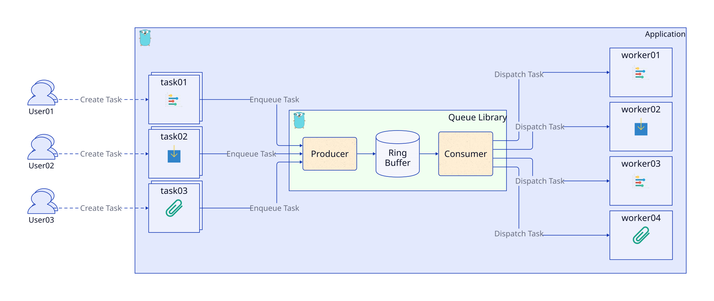
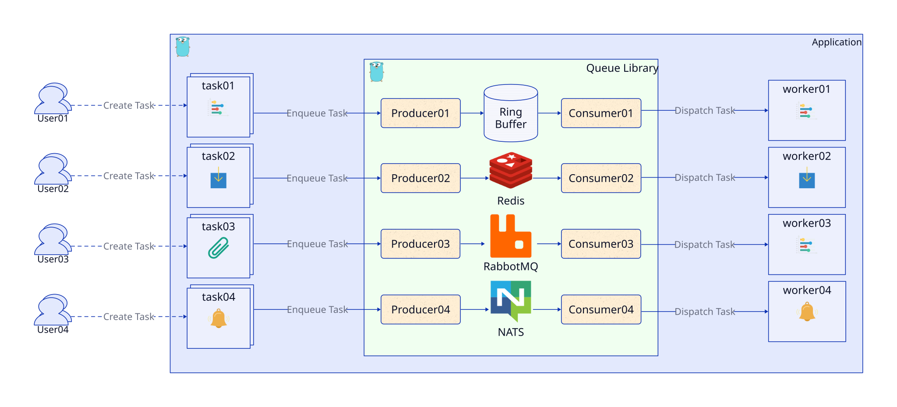
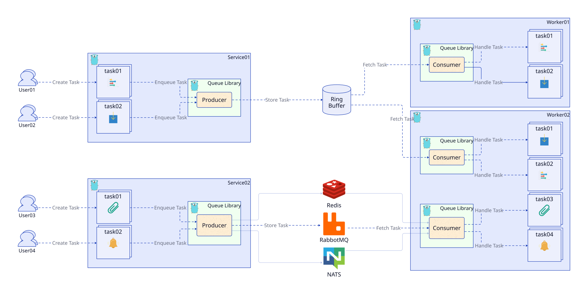

# 队列

[](https://github.com/golang-queue/queue/actions/workflows/codeql.yaml)
[](https://github.com/golang-queue/queue/actions/workflows/go.yml)
[](https://codecov.io/gh/golang-queue/queue)
[](https://github.com/golang-queue/queue/actions/workflows/security.yml)

[English](./README.md) | [繁體中文](./README.zh-tw.md)

Queue 是一个 Golang 库，帮助您创建和管理 Goroutines（轻量级线程）池。它允许您高效地并行运行多个任务，利用机器的 CPU 容量。

## 目录

- [安装](#安装)
- [使用](#使用)
- [配置与生命周期](#配置与生命周期)
- [开发与验证](#开发与验证)
- 后端：[NSQ](#使用-nsq-作为队列)、[NATS](#使用-nats-作为队列)、[Redis Pub/Sub](#使用-redis-pubsub-作为队列)

## 特性

- [x] 支持 [循环缓冲区](https://en.wikipedia.org/wiki/Circular_buffer) 队列。
- [x] 集成 [NSQ](https://nsq.io/) 进行实时分布式消息传递。
- [x] 集成 [NATS](https://nats.io/) 以适应边缘和分布式系统。
- [x] 集成 [Redis Pub/Sub](https://redis.io/docs/manual/pubsub/)。
- [x] 集成 [Redis Streams](https://redis.io/docs/manual/data-types/streams/)。
- [x] 集成 [RabbitMQ](https://www.rabbitmq.com/)。

## 队列场景

使用环形缓冲区作为默认后端的简单队列服务。



轻松切换队列服务以使用 NSQ、NATS 或 Redis。



支持多个生产者和消费者。



## 要求

当前分支根据 [go.mod](./go.mod) 需要 Go **1.26.10** 或以上版本；已发布版本的要求可能不同。

## 安装

安装最新标签版本：

```sh
go get github.com/golang-queue/queue@latest
```

安装开发分支：

```sh
go get github.com/golang-queue/queue@master
```

## 使用

### 池的基本用法（使用 Task 函数）

通过调用 `QueueTask()` 方法，您可以安排任务由池中的工作者（Goroutines）执行。

```go
package main

import (
	"context"
	"fmt"

	"github.com/golang-queue/queue"
)

func main() {
	taskN := 100
	rets := make(chan string, taskN)

	// 初始化队列池
	q := queue.NewPool(5)
	// 关闭服务并通知所有工作者
	// 等待所有作业完成
	defer q.Release()

	// 将任务分配到队列
	for i := 0; i < taskN; i++ {
		if err := q.QueueTask(func(ctx context.Context) error {
			rets <- fmt.Sprintf("Hi Gopher, 处理作业: %02d", i)
			return nil
		}); err != nil {
			panic(err)
		}
	}

	// 等待所有任务完成
	for i := 0; i < taskN; i++ {
		fmt.Println("消息:", <-rets)
	}
}
```

### 池的基本用法（使用消息队列）

定义一个新的消息结构并实现 `Bytes()` 函数来编码消息。使用 `WithFn` 函数处理来自队列的消息。

```go
package main

import (
	"context"
	"encoding/json"
	"fmt"

	"github.com/golang-queue/queue"
	"github.com/golang-queue/queue/core"
)

type job struct {
	Name    string
	Message string
}

func (j *job) Bytes() []byte {
	b, err := json.Marshal(j)
	if err != nil {
		panic(err)
	}
	return b
}

func main() {
	taskN := 100
	rets := make(chan string, taskN)

	// 初始化队列池
	q := queue.NewPool(5, queue.WithFn(func(ctx context.Context, m core.TaskMessage) error {
		var v job
		if err := json.Unmarshal(m.Payload(), &v); err != nil {
			return err
		}

		rets <- "Hi, " + v.Name + ", " + v.Message
		return nil
	}))
	// 关闭服务并通知所有工作者
	// 等待所有作业完成
	defer q.Release()

	// 将任务分配到队列
	for i := 0; i < taskN; i++ {
		if err := q.Queue(&job{
			Name:    "Gopher",
			Message: fmt.Sprintf("处理作业: %d", i+1),
		}); err != nil {
			panic(err)
		}
	}

	// 等待所有任务完成
	for i := 0; i < taskN; i++ {
		fmt.Println("消息:", <-rets)
	}
}
```

## 配置与生命周期

`NewPool(n, opts...)` 创建内存环形缓冲区并立即开始处理任务。`n` 小于或等于零时使用 `runtime.NumCPU()`。`NewQueue(opts...)` 必须指定 `WithWorker(...)`，缺少 worker 时返回错误，并且需要显式调用 `Start()`。

`QueueTask` 用于提交在当前进程执行的 Go 函数。需要序列化消息时，使用 `Queue` 并实现消息的 `Bytes() []byte`；处理函数通过 `core.TaskMessage.Payload()` 读取原始内容。默认环形缓冲区的处理函数由 `WithFn` 配置，未配置时不会处理消息内容。函数闭包不会被序列化到外部后端。

两种提交方法返回的都是入队错误，不是任务执行结果。任务并发执行，因此完成顺序不保证与提交顺序相同。示例直接提交任务，不需要为每次提交额外创建 goroutine。示例的结果 channel 可容纳全部任务的结果，并假设每个成功入队的任务都会返回一条结果；如果处理函数可能失败，也应返回包含错误的结果，避免调用方一直等待。

| 选项 | 默认值 | 行为 |
| --- | --- | --- |
| `WithQueueSize(n)` | `0`（不设上限） | 限制环形缓冲区内等待中的任务数，不含执行中的任务。满载时立即返回 `ErrMaxCapacity`。 |
| `WithWorkerCount(n)` | `runtime.NumCPU()` | 设置并发执行数；传入 `NewPool` 时会覆盖其 size 参数。 |
| `WithRetryInterval(d)` | `time.Second` | 无任务时的轮询间隔，必须大于零；这不是任务重试间隔。 |
| `WithLogger(logger)` | 标准 stderr logger | 可使用 `NewEmptyLogger()` 关闭日志。 |
| `WithAfterFn(fn)` | 无 | 任务成功或失败、统计更新后执行；回调可能同时执行，共享数据需自行同步。 |

调用 `Release()` 前，先停止生产者提交任务。默认环形缓冲区在关闭时会拒绝新任务并返回 `ErrQueueShutdown`，同时处理等待中的任务。`Release()` 也会等待队列管理的 goroutine 与完成回调结束。关闭过程可能取消执行中任务的 context，不代表每个任务都会成功。外部后端的排空行为取决于各自的 worker 实现。

`Wait()` 等待的是队列 goroutine 结束，不能用来等待仍在运行的队列变为空闲；这类需求应使用应用程序自己的完成通知。排空期间需保留运行中的 worker：`UpdateWorkerCount(0)` 会暂停派发，因此有待处理任务时，请先恢复正数再调用 `Release()`。不要在任务或完成回调内调用 `Release()`，否则会等待自身结束。

### 任务重试与超时

将一个 `job.AllowOption` 传给 `QueueTask` 或 `Queue`，即可覆盖任务默认值。以下选项需导入 `github.com/golang-queue/queue/job` 与 `time`：

```go
opts := job.AllowOption{
    RetryCount: job.Int64(3),
    RetryDelay: job.Time(200 * time.Millisecond),
    Timeout:    job.Time(5 * time.Second),
}
// 将 opts 作为 q.QueueTask 或 q.Queue 的第二个参数。
```

默认不重试，超时为 60 分钟。`RetryCount: 3` 表示处理函数返回错误时，最多执行四次。重试间隔为零时，使用指数退避：从 100 毫秒开始，每次加倍，上限为 10 秒。超时覆盖整个任务，包括重试与等待时间。

处理函数应检查 `ctx.Done()`，并将 context 传给可取消的 I/O 操作。超时会记录失败，但无法强制停止忽略取消信号的 Go 函数；这类函数可能在 `Release()` 返回后继续执行。可重试的操作应能安全地重复执行。

### 统计信息

可通过 `SubmittedTasks()`、`CompletedTasks()`、`SuccessTasks()`、`FailureTasks()` 与 `BusyWorkers()` 查看状态。重试属于同一个任务，不会被算作额外提交。请在 `Release()` 后读取最终统计；并发读取时取得的是快照，不是同一个事务的状态。

## 开发与验证

在项目根目录运行测试：

```sh
go test ./...
go test -race ./...
```

更多集成细节请参考[可运行示例](./_example/)与 [worker 接口](./core/worker.go)。外部后端需要另行安装对应的 Go 模块并启动服务；配置方法与消息传递保证请参考下方各后端文档。

## 使用 NSQ 作为队列

请参阅 [NSQ 文档](https://github.com/golang-queue/nsq) 了解更多详情。

```go
package main

import (
	"context"
	"encoding/json"
	"fmt"

	"github.com/golang-queue/nsq"
	"github.com/golang-queue/queue"
	"github.com/golang-queue/queue/core"
)

type job struct {
	Message string
}

func (j *job) Bytes() []byte {
	b, err := json.Marshal(j)
	if err != nil {
		panic(err)
	}
	return b
}

func main() {
	taskN := 100
	rets := make(chan string, taskN)

	// 定义工作者
	w := nsq.NewWorker(
		nsq.WithAddr("127.0.0.1:4150"),
		nsq.WithTopic("example"),
		nsq.WithChannel("foobar"),
		// 并发作业数量
		nsq.WithMaxInFlight(10),
		nsq.WithRunFunc(func(ctx context.Context, m core.TaskMessage) error {
			var v job
			if err := json.Unmarshal(m.Payload(), &v); err != nil {
				return err
			}

			rets <- v.Message
			return nil
		}),
	)

	// 定义队列
	q := queue.NewPool(
		5,
		queue.WithWorker(w),
	)

	// 将任务分配到队列
	for i := 0; i < taskN; i++ {
		if err := q.Queue(&job{
			Message: fmt.Sprintf("处理作业: %d", i+1),
		}); err != nil {
			panic(err)
		}
	}

	// 等待所有任务完成
	for i := 0; i < taskN; i++ {
		fmt.Println("消息:", <-rets)
	}

	// 关闭服务并通知所有工作者
	q.Release()
}
```

## 使用 NATS 作为队列

请参阅 [NATS 文档](https://github.com/golang-queue/nats) 了解更多详情。

```go
package main

import (
	"context"
	"encoding/json"
	"fmt"
	"log"

	"github.com/golang-queue/nats"
	"github.com/golang-queue/queue"
	"github.com/golang-queue/queue/core"
)

type job struct {
	Message string
}

func (j *job) Bytes() []byte {
	b, err := json.Marshal(j)
	if err != nil {
		panic(err)
	}
	return b
}

func main() {
	taskN := 100
	rets := make(chan string, taskN)

	// 定义工作者
	w := nats.NewWorker(
		nats.WithAddr("127.0.0.1:4222"),
		nats.WithSubj("example"),
		nats.WithQueue("foobar"),
		nats.WithRunFunc(func(ctx context.Context, m core.TaskMessage) error {
			var v job
			if err := json.Unmarshal(m.Payload(), &v); err != nil {
				return err
			}

			rets <- v.Message
			return nil
		}),
	)

	// 定义队列
	q, err := queue.NewQueue(
		queue.WithWorkerCount(10),
		queue.WithWorker(w),
	)
	if err != nil {
		log.Fatal(err)
	}

	// 启动工作者
	q.Start()

	// 将任务分配到队列
	for i := 0; i < taskN; i++ {
		if err := q.Queue(&job{
			Message: fmt.Sprintf("处理作业: %d", i+1),
		}); err != nil {
			panic(err)
		}
	}

	// 等待所有任务完成
	for i := 0; i < taskN; i++ {
		fmt.Println("消息:", <-rets)
	}

	// 关闭服务并通知所有工作者
	q.Release()
}
```

## 使用 Redis (Pub/Sub) 作为队列

请参阅 [Redis 文档](https://github.com/golang-queue/redisdb) 了解更多详情。

```go
package main

import (
	"context"
	"encoding/json"
	"fmt"
	"log"

	"github.com/golang-queue/queue"
	"github.com/golang-queue/queue/core"
	"github.com/golang-queue/redisdb"
)

type job struct {
	Message string
}

func (j *job) Bytes() []byte {
	b, err := json.Marshal(j)
	if err != nil {
		panic(err)
	}
	return b
}

func main() {
	taskN := 100
	rets := make(chan string, taskN)

	// 定义工作者
	w := redisdb.NewWorker(
		redisdb.WithAddr("127.0.0.1:6379"),
		redisdb.WithChannel("foobar"),
		redisdb.WithRunFunc(func(ctx context.Context, m core.TaskMessage) error {
			var v job
			if err := json.Unmarshal(m.Payload(), &v); err != nil {
				return err
			}

			rets <- v.Message
			return nil
		}),
	)

	// 定义队列
	q, err := queue.NewQueue(
		queue.WithWorkerCount(10),
		queue.WithWorker(w),
	)
	if err != nil {
		log.Fatal(err)
	}

	// 启动工作者
	q.Start()

	// 将任务分配到队列
	for i := 0; i < taskN; i++ {
		if err := q.Queue(&job{
			Message: fmt.Sprintf("处理作业: %d", i+1),
		}); err != nil {
			panic(err)
		}
	}

	// 等待所有任务完成
	for i := 0; i < taskN; i++ {
		fmt.Println("消息:", <-rets)
	}

	// 关闭服务并通知所有工作者
	q.Release()
}
```
