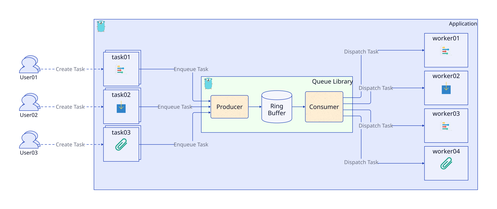
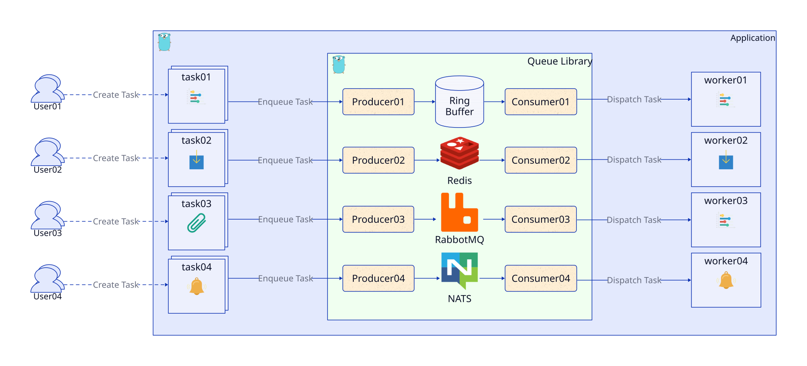
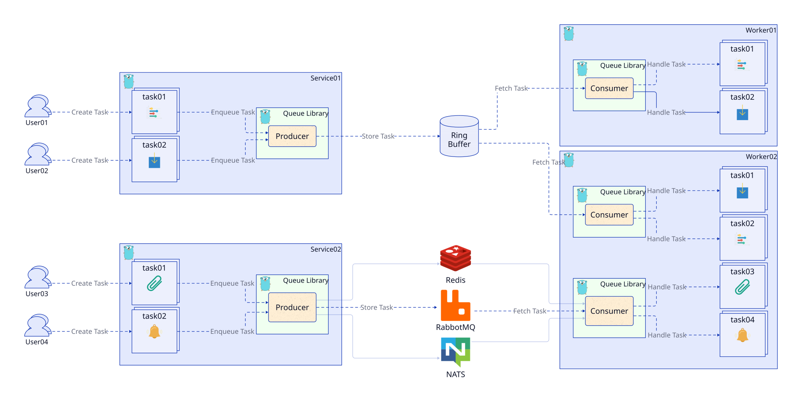

# Queue

[](https://github.com/golang-queue/queue/actions/workflows/codeql.yaml)
[](https://github.com/golang-queue/queue/actions/workflows/go.yml)
[](https://codecov.io/gh/golang-queue/queue)
[](https://github.com/golang-queue/queue/actions/workflows/security.yml)

[English](./README.md) | [简体中文](./README.zh-cn.md)

Queue 是一個 Golang 函式庫，幫助你建立和管理 Goroutines（輕量級執行緒）的池。它允許你有效地並行執行多個任務，充分利用機器的 CPU 容量。

## 目錄

- [安裝](#安裝)
- [使用方法](#使用方法)
- [設定與生命週期](#設定與生命週期)
- [開發與驗證](#開發與驗證)
- 後端：[NSQ](#使用-nsq-作為隊列)、[NATS](#使用-nats-作為隊列)、[Redis Pub/Sub](#使用-redis-pubsub-作為隊列)

## 功能

- [x] 支援 [環形緩衝區](https://en.wikipedia.org/wiki/Circular_buffer) 隊列。
- [x] 與 [NSQ](https://nsq.io/) 整合，用於即時分佈式消息傳遞。
- [x] 與 [NATS](https://nats.io/) 整合，用於自適應邊緣和分佈式系統。
- [x] 與 [Redis Pub/Sub](https://redis.io/docs/manual/pubsub/) 整合。
- [x] 與 [Redis Streams](https://redis.io/docs/manual/data-types/streams/) 整合。
- [x] 與 [RabbitMQ](https://www.rabbitmq.com/) 整合。

## 隊列場景

使用環形緩衝區作為預設後端的簡單隊列服務。



輕鬆切換隊列服務以使用 NSQ、NATS 或 Redis。



支援多個生產者和消費者。



## 要求

目前分支依據 [go.mod](./go.mod) 需要 Go **1.26.10** 或以上版本；已發布版本的需求可能不同。

## 安裝

安裝最新標記版本：

```sh
go get github.com/golang-queue/queue@latest
```

安裝開發分支：

```sh
go get github.com/golang-queue/queue@master
```

## 使用方法

### 池的基本使用（使用 Task 函數）

通過調用 `QueueTask()` 方法，你可以安排任務由池中的工作者（Goroutines）執行。

```go
package main

import (
	"context"
	"fmt"

	"github.com/golang-queue/queue"
)

func main() {
	taskN := 100
	rets := make(chan string, taskN)

	// 初始化隊列池
	q := queue.NewPool(5)
	// 關閉服務並通知所有工作者
	// 等待所有工作完成
	defer q.Release()

	// 將任務分配給隊列
	for i := 0; i < taskN; i++ {
		if err := q.QueueTask(func(ctx context.Context) error {
			rets <- fmt.Sprintf("Hi Gopher, 處理工作: %02d", i)
			return nil
		}); err != nil {
			panic(err)
		}
	}

	// 等待所有任務完成
	for i := 0; i < taskN; i++ {
		fmt.Println("message:", <-rets)
	}
}
```

### 池的基本使用（使用消息隊列）

定義一個新的消息結構並實現 `Bytes()` 函數來編碼消息。使用 `WithFn` 函數來處理來自隊列的消息。

```go
package main

import (
	"context"
	"encoding/json"
	"fmt"

	"github.com/golang-queue/queue"
	"github.com/golang-queue/queue/core"
)

type job struct {
	Name    string
	Message string
}

func (j *job) Bytes() []byte {
	b, err := json.Marshal(j)
	if err != nil {
		panic(err)
	}
	return b
}

func main() {
	taskN := 100
	rets := make(chan string, taskN)

	// 初始化隊列池
	q := queue.NewPool(5, queue.WithFn(func(ctx context.Context, m core.TaskMessage) error {
		var v job
		if err := json.Unmarshal(m.Payload(), &v); err != nil {
			return err
		}

		rets <- "Hi, " + v.Name + ", " + v.Message
		return nil
	}))
	// 關閉服務並通知所有工作者
	// 等待所有工作完成
	defer q.Release()

	// 將任務分配給隊列
	for i := 0; i < taskN; i++ {
		if err := q.Queue(&job{
			Name:    "Gopher",
			Message: fmt.Sprintf("處理工作: %d", i+1),
		}); err != nil {
			panic(err)
		}
	}

	// 等待所有任務完成
	for i := 0; i < taskN; i++ {
		fmt.Println("message:", <-rets)
	}
}
```

## 設定與生命週期

`NewPool(n, opts...)` 會建立記憶體環形緩衝區並立即開始處理任務。`n` 小於或等於零時使用 `runtime.NumCPU()`。`NewQueue(opts...)` 必須指定 `WithWorker(...)`，缺少 worker 時會回傳錯誤，且需要自行呼叫 `Start()`。

`QueueTask` 用於提交在目前程序執行的 Go 函式。需要序列化訊息時，使用 `Queue` 並實作訊息的 `Bytes() []byte`；處理函式透過 `core.TaskMessage.Payload()` 讀取原始內容。預設環形緩衝區的處理函式由 `WithFn` 設定，未設定時不會處理訊息內容。函式閉包不會被序列化至外部後端。

兩種提交方法回傳的都是入列錯誤，不是任務執行結果。任務會並行執行，因此完成順序不保證與提交順序相同。範例直接提交任務，不需要為每次提交額外建立 goroutine。範例的結果 channel 可容納全部任務的結果，並假設每個成功入列的任務都會傳回一筆結果；若處理函式可能失敗，也應傳回包含錯誤的結果，避免呼叫端一直等待。

| 選項 | 預設值 | 行為 |
| --- | --- | --- |
| `WithQueueSize(n)` | `0`（不設上限） | 限制環形緩衝區內等待中的任務數，不含執行中的任務。滿載時立即回傳 `ErrMaxCapacity`。 |
| `WithWorkerCount(n)` | `runtime.NumCPU()` | 設定並行執行數；傳入 `NewPool` 時會覆蓋其 size 參數。 |
| `WithRetryInterval(d)` | `time.Second` | 無任務時的輪詢間隔，必須大於零；這不是任務重試間隔。 |
| `WithLogger(logger)` | 標準 stderr logger | 可使用 `NewEmptyLogger()` 關閉日誌。 |
| `WithAfterFn(fn)` | 無 | 任務成功或失敗、統計更新後執行；回呼可能同時執行，共用資料需自行同步。 |

呼叫 `Release()` 前，先停止生產者提交任務。預設環形緩衝區在關閉時會拒絕新任務並回傳 `ErrQueueShutdown`，同時消化等待中的任務。`Release()` 也會等待佇列管理的 goroutine 與完成回呼結束。關閉過程可能取消執行中任務的 context，不代表每個任務都會成功。外部後端的排空行為取決於各自的 worker 實作。

`Wait()` 等待的是佇列 goroutine 結束，不能用來等待仍在運作的佇列變成閒置；這類需求應使用應用程式自己的完成通知。排空期間需保留執行中的 worker：`UpdateWorkerCount(0)` 會暫停派發，因此有待處理任務時，請先恢復正數再呼叫 `Release()`。不要在任務或完成回呼內呼叫 `Release()`，否則會等待自身結束。

### 任務重試與逾時

將一個 `job.AllowOption` 傳給 `QueueTask` 或 `Queue`，即可覆蓋任務預設值。以下選項需匯入 `github.com/golang-queue/queue/job` 與 `time`：

```go
opts := job.AllowOption{
    RetryCount: job.Int64(3),
    RetryDelay: job.Time(200 * time.Millisecond),
    Timeout:    job.Time(5 * time.Second),
}
// 將 opts 作為 q.QueueTask 或 q.Queue 的第二個參數。
```

預設不重試，逾時為 60 分鐘。`RetryCount: 3` 表示處理函式回傳錯誤時，最多執行四次。重試間隔為零時，使用指數退避：從 100 毫秒開始，每次加倍，上限為 10 秒。逾時涵蓋整個任務，包含重試與等待時間。

處理函式應檢查 `ctx.Done()`，並將 context 傳給可取消的 I/O 操作。逾時會記錄失敗，但無法強制停止忽略取消訊號的 Go 函式；這類函式可能在 `Release()` 回傳後繼續執行。可重試的操作應能安全地重複執行。

### 統計資訊

可透過 `SubmittedTasks()`、`CompletedTasks()`、`SuccessTasks()`、`FailureTasks()` 與 `BusyWorkers()` 查看狀態。重試屬於同一個任務，不會被算成額外提交。請在 `Release()` 後讀取最終統計；並行讀取時取得的是快照，不是同一筆交易的狀態。

## 開發與驗證

在專案根目錄執行測試：

```sh
go test ./...
go test -race ./...
```

更多整合細節請參考[可執行範例](./_example/)與 [worker 介面](./core/worker.go)。外部後端需要另行安裝對應的 Go 模組並啟動服務；設定方式與訊息傳遞保證請參考下方各後端文件。

## 使用 NSQ 作為隊列

請參閱 [NSQ 文檔](https://github.com/golang-queue/nsq) 以獲取更多詳細信息。

```go
package main

import (
	"context"
	"encoding/json"
	"fmt"

	"github.com/golang-queue/nsq"
	"github.com/golang-queue/queue"
	"github.com/golang-queue/queue/core"
)

type job struct {
	Message string
}

func (j *job) Bytes() []byte {
	b, err := json.Marshal(j)
	if err != nil {
		panic(err)
	}
	return b
}

func main() {
	taskN := 100
	rets := make(chan string, taskN)

	// 定義工作者
	w := nsq.NewWorker(
		nsq.WithAddr("127.0.0.1:4150"),
		nsq.WithTopic("example"),
		nsq.WithChannel("foobar"),
		// 並發工作數量
		nsq.WithMaxInFlight(10),
		nsq.WithRunFunc(func(ctx context.Context, m core.TaskMessage) error {
			var v job
			if err := json.Unmarshal(m.Payload(), &v); err != nil {
				return err
			}

			rets <- v.Message
			return nil
		}),
	)

	// 定義隊列
	q := queue.NewPool(
		5,
		queue.WithWorker(w),
	)

	// 將任務分配給隊列
	for i := 0; i < taskN; i++ {
		if err := q.Queue(&job{
			Message: fmt.Sprintf("處理工作: %d", i+1),
		}); err != nil {
			panic(err)
		}
	}

	// 等待所有任務完成
	for i := 0; i < taskN; i++ {
		fmt.Println("message:", <-rets)
	}

	// 關閉服務並通知所有工作者
	q.Release()
}
```

## 使用 NATS 作為隊列

請參閱 [NATS 文檔](https://github.com/golang-queue/nats) 以獲取更多詳細信息。

```go
package main

import (
	"context"
	"encoding/json"
	"fmt"
	"log"

	"github.com/golang-queue/nats"
	"github.com/golang-queue/queue"
	"github.com/golang-queue/queue/core"
)

type job struct {
	Message string
}

func (j *job) Bytes() []byte {
	b, err := json.Marshal(j)
	if err != nil {
		panic(err)
	}
	return b
}

func main() {
	taskN := 100
	rets := make(chan string, taskN)

	// 定義工作者
	w := nats.NewWorker(
		nats.WithAddr("127.0.0.1:4222"),
		nats.WithSubj("example"),
		nats.WithQueue("foobar"),
		nats.WithRunFunc(func(ctx context.Context, m core.TaskMessage) error {
			var v job
			if err := json.Unmarshal(m.Payload(), &v); err != nil {
				return err
			}

			rets <- v.Message
			return nil
		}),
	)

	// 定義隊列
	q, err := queue.NewQueue(
		queue.WithWorkerCount(10),
		queue.WithWorker(w),
	)
	if err != nil {
		log.Fatal(err)
	}

	// 啟動工作者
	q.Start()

	// 將任務分配給隊列
	for i := 0; i < taskN; i++ {
		if err := q.Queue(&job{
			Message: fmt.Sprintf("處理工作: %d", i+1),
		}); err != nil {
			panic(err)
		}
	}

	// 等待所有任務完成
	for i := 0; i < taskN; i++ {
		fmt.Println("message:", <-rets)
	}

	// 關閉服務並通知所有工作者
	q.Release()
}
```

## 使用 Redis (Pub/Sub) 作為隊列

請參閱 [Redis 文檔](https://github.com/golang-queue/redisdb) 以獲取更多詳細信息。

```go
package main

import (
	"context"
	"encoding/json"
	"fmt"
	"log"

	"github.com/golang-queue/queue"
	"github.com/golang-queue/queue/core"
	"github.com/golang-queue/redisdb"
)

type job struct {
	Message string
}

func (j *job) Bytes() []byte {
	b, err := json.Marshal(j)
	if err != nil {
		panic(err)
	}
	return b
}

func main() {
	taskN := 100
	rets := make(chan string, taskN)

	// 定義工作者
	w := redisdb.NewWorker(
		redisdb.WithAddr("127.0.0.1:6379"),
		redisdb.WithChannel("foobar"),
		redisdb.WithRunFunc(func(ctx context.Context, m core.TaskMessage) error {
			var v job
			if err := json.Unmarshal(m.Payload(), &v); err != nil {
				return err
			}

			rets <- v.Message
			return nil
		}),
	)

	// 定義隊列
	q, err := queue.NewQueue(
		queue.WithWorkerCount(10),
		queue.WithWorker(w),
	)
	if err != nil {
		log.Fatal(err)
	}

	// 啟動工作者
	q.Start()

	// 將任務分配給隊列
	for i := 0; i < taskN; i++ {
		if err := q.Queue(&job{
			Message: fmt.Sprintf("處理工作: %d", i+1),
		}); err != nil {
			panic(err)
		}
	}

	// 等待所有任務完成
	for i := 0; i < taskN; i++ {
		fmt.Println("message:", <-rets)
	}

	// 關閉服務並通知所有工作者
	q.Release()
}
```
