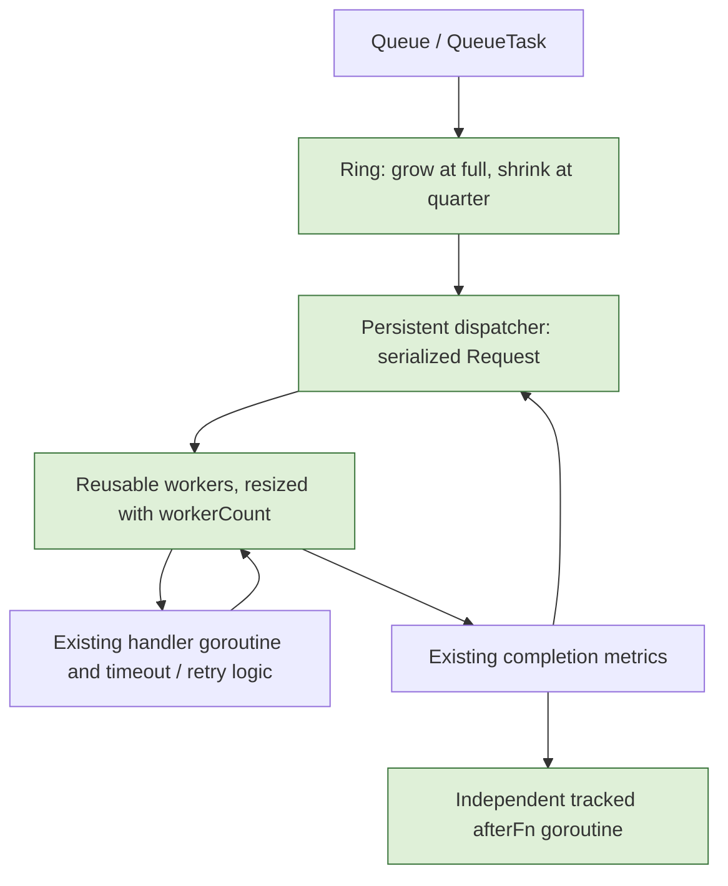

# Queue performance implementation plan

## Goal and classification

Implement the two optimizations requested by the repository owner: stop Ring
resize oscillation and reuse dispatch/execution goroutines. Preserve public APIs,
serialized backend Request calls, retry/timeout/panic handling, dynamic worker
limits, and graceful draining. This is CORE CODE: all consumers depend on it,
orchestration must remain extensible, debt and failures propagate, and changes
need line-by-line review. Recommended release review: module owner plus another
reviewer. The user's instruction to implement items 1 and 2 authorizes this work.

## Flow

## Scope and constraints

- May modify ring.go, queue.go, options.go callback documentation, focused
  tests/benchmarks, this plan, and performance documentation.
- No public interface changes, dependency upgrades, timer/channel-result redesign,
  lock-free queue, or task cancellation semantic changes.
- Keep a handler goroutine per task: timeout must still release the queue slot
  even when a handler does not cooperate with cancellation.
- Workers complete their current task before retiring after a size decrease.
- Preserve callback independence: afterFn must be able to wait for another queued
  task without holding a worker slot. Track callback goroutines through Release.
- Keep Request serialized, including custom blocking backends.

## Verification

- Establish the existing race-test baseline before product edits.
- Ring: FIFO across wrap/grow/shrink, maximum capacity, and no oscillation around
  a power-of-two boundary; verify actual shrink still releases capacity.
- Queue: complete every accepted task once, preserve error/panic/timeout/retry
  metrics and callbacks, drain on shutdown, increase/decrease/pause/resume worker
  count, and release workers without leaks (existing goleak TestMain).
- Test a custom blocking backend and serialized Request compatibility.
- Run full race/coverage suite and repository lint; stress focused lifecycle tests.
- Run identical benchmark source against the original commit, Ring-only change,
  and final change. Measure completed work, check enqueue errors, and report
  repeated samples, allocation counts, environment, and limitations.

## Done and rollback

Done when both optimizations pass the checks and a reproducible before/after
report is saved, followed by the requested commit and PR. Rollback consists of reverting
the ring threshold and dispatcher/worker changes together with related tests.
Main risk: changed scheduling exposes shutdown or dynamic-scaling races; keep
handler execution logic intact and use targeted deterministic synchronization.
